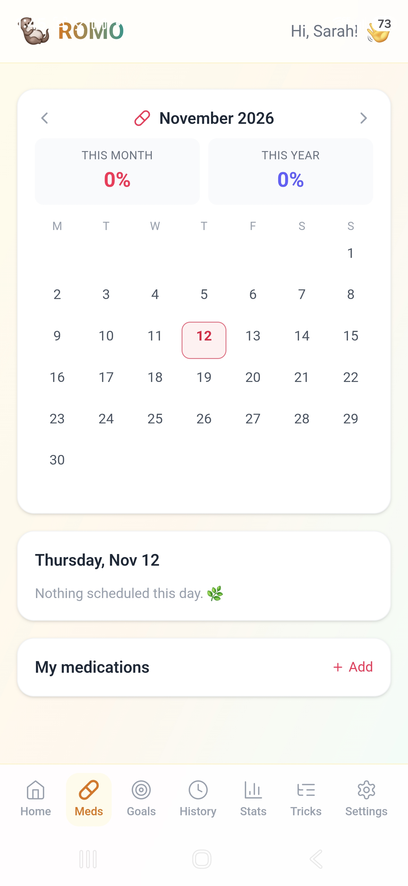

# 🦦 ROMO — Your Wellness Companion

<p align="center">
  <i>A cozy little otter for your habits, sleep, movement, goals, meds & meals.<br>
  Everything lives <b>only on your device</b> — no accounts, no servers, no tracking, no AI. 💛</i>
</p>

<p align="center">
  🦦 
  🌱 
  🔒 
  🤖 
  <a href="https://github.com/Nyahmii/Romoo/releases"></a>
</p>

<p align="center"><sub>🎨 the otter palette</sub></p>
<p align="center">
  🟤 
  🟠 
  🔵 
  🩵 
  🟢 
</p>

<p align="center">🐾 ─  ─ </p>
---

### 📸 A Peek at Romo 🦦

> Your wellness otter, in action — habits, meds, meals & stats, all on-device.

<table>
  <tr>
    <td align="center"><h4>📊 Year-at-a-Glance Stats</h4></td>
    <td align="center"><h4>🔒 Profile &amp; Security</h4></td>
    <td align="center"><h4>💾 Backup &amp; Danger Zone</h4></td>
  </tr>
  <tr>
    <td align="center"><h4>🔄 In-App Updates</h4></td>
    <td align="center"><h4>🛹 Trick Flow Tree</h4></td>
    <td align="center"><h4>💊 Medication Tracking</h4></td>
  </tr>
</table>

<p align="center">🐾 ─ 🦦 ─ 🐾</p>

---

## 📥 Download the App (Android)

**Get the APK here → [ROMO Releases](https://github.com/Nyahmii/Romoo/releases)** 🦶

1. Open the link above and click the **newest release** (top of the list).
2. Under **Assets**, tap **`app-release.apk`** to download it.
3. Open the downloaded file on your phone and install it (allow "install from unknown sources" if asked).

### 🔄 Updating the app (over-the-air)
No need to re-download every time — Romo updates itself:

1. Open Romo.
2. Go to **Settings** (bottom-right tab).
3. **Scroll down** to the bottom of the page.
4. Tap **Check for updates**.
5. If an update is ready, tap **Update** → your browser downloads it → tap **Install**.

Your check-ins, meds, recipes & goals stay safe through every update. 💛

---

## ✨ What Romo Does

- 🌤️ **Daily check-ins** — mood, energy, gratitude & little notes
- 😴 **Sleep tracker** — including interrupted / multi-block nights
- 🏃 **Movement tracker** — walks, yoga, dance, stretching
- 🎯 **Goals** — a tidy board (Active / On Hold / Done) with nested tasks
- 💊 **Medications** — daily, every‑X‑days, weekly, bi‑weekly or monthly schedules, with reminders & refill alerts
- 🍽️ **Recipes** — search open sources, filter by diet (🌱 vegan · 🥦 vegetarian · 🌾 gluten‑free · 🥛 dairy‑free · 🥜 nut‑free · 🥚 egg‑free), or import any recipe link ad‑free into your personal Recipe Box
- 📈 **Stats** — charts for mood, sleep, movement & med adherence
- 🔐 **Privacy** — optional PIN lock + JSON backup export/import

---

## 🛠️ Build It Yourself

**You need:** Node.js 18+, Android Studio (with JDK 17), Git.

```bash
git clone https://github.com/Nyahmii/Romoo.git
cd Romoo
npm install
npm run build
npx cap sync android
```

**Debug APK (testing only):**
```bash
cd android && ./gradlew assembleDebug
# → android/app/build/outputs/apk/debug/app-debug.apk
```

**Signed release APK (needed for OTA updates):** keep your keystore *outside* the repo and point Gradle at it with environment variables (`ROMO_STORE_PW`, `ROMO_KEY_PW`), then:
```bash
cd android && ./gradlew assembleRelease
# → android/app/build/outputs/apk/release/app-release.apk
```
⚠️ Always sign releases with the **same keystore** and raise the **versionCode**, or phones won't accept the update.

---

## 💻 Development

```bash
npm run dev      # local dev server
npm run build    # production build
```

---

## 🤝 Contributing

Fork → branch → commit → pull request. Ideas welcome: more diet tags, dark mode, CSV export, more affirmations. 🐾

## 📝 License

MIT — see [LICENSE](./LICENSE).

---

## 🦦 About Romo
Romo is more than an app — it's your friendly otter on your wellness journey: habits, goals, meds, meals, and stats, all kept privately on your device.

**Progress, not perfection. You're doing amazing!** 💛
