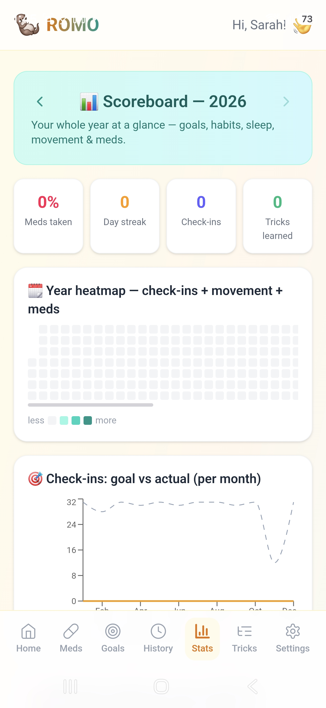
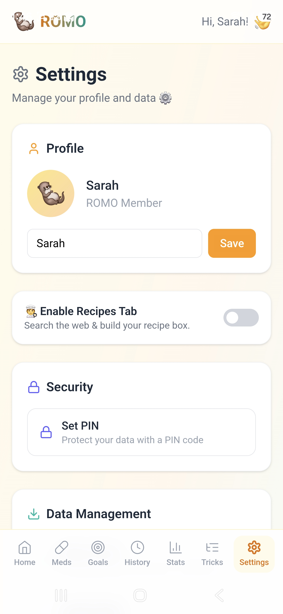
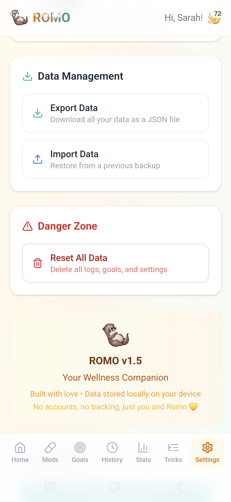
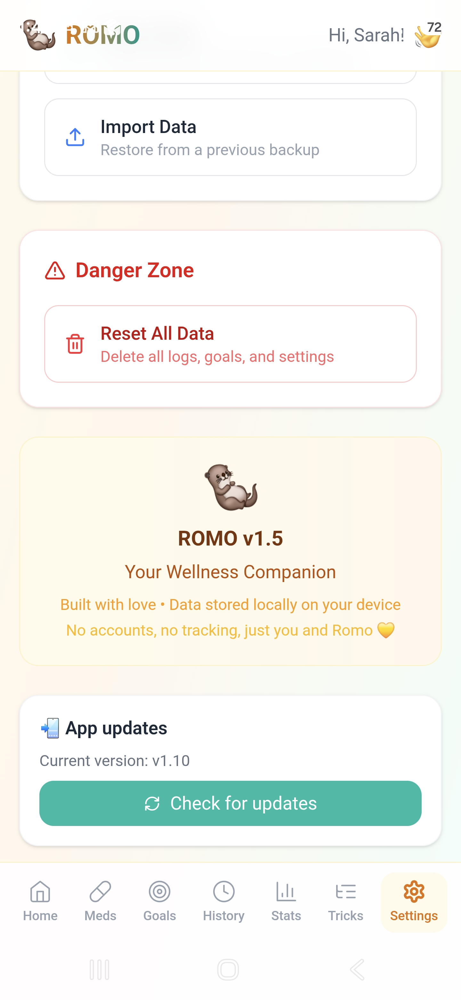
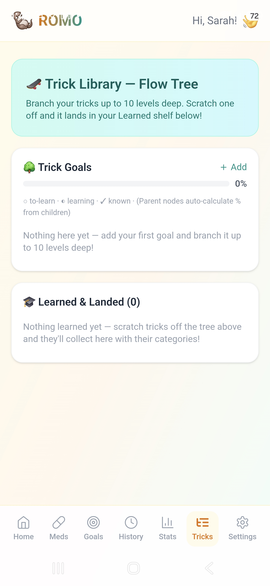

# 🦦 ROMO — Your Wellness Companion

A cute otter-themed wellness app: habits, sleep, movement, goals, medications, and recipes. Everything is stored **only on your device** — no accounts, no servers, no tracking.

---

<h3>📸 Screenshots</h3>

<table>
  <tr>
    <td align="center"><br><sub>Year-at-a-glance Stats</sub></td>
    <td align="center"><br><sub>Profile &amp; Security</sub></td>
    <td align="center"><br><sub>Backup &amp; Danger Zone</sub></td>
  </tr>
  <tr>
    <td align="center"><br><sub>In-app updates</sub></td>
    <td align="center"><br><sub>Trick Flow Tree</sub></td>
    <td></td>
  </tr>
</table>

## 📥 Download the App (Android)

**Get the APK here → [ROMO Releases](https://github.com/Nyahmii/Romoo/releases)**

1. Open the link above and click the **newest release** (top of the list).
2. Under **Assets**, tap **`app-release.apk`** to download it.
3. Open the downloaded file on your phone and install it (allow "install from unknown sources" if asked).

### 🔄 Updating the app (over-the-air)
You don't need to download a new APK every time:

1. Open Romo.
2. Go to **Settings** (bottom-right tab).
3. **Scroll down** to the bottom of the page.
4. Tap **Check for updates**.
5. If an update is available, tap **Update** → your browser downloads it → tap **Install**.

Your data (check-ins, meds, recipes, goals) stays safe during updates.

---

## ✨ What Romo Does

- **Daily check-ins** — mood, energy, gratitude, notes
- **Sleep tracker** — including interrupted/multi-block nights
- **Movement tracker** — walks, yoga, dance, stretching
- **Goals** — a simple board (Active / On Hold / Done) with nested tasks
- **Medications** — daily, every-X-days, weekly, bi-weekly, or monthly schedules, with reminders and refill alerts
- **Recipes** — search open recipe sources, filter by diet (vegan, vegetarian, gluten-free, dairy-free, nut-free, egg-free), or import any recipe link ad-free into your personal Recipe Box
- **Stats** — charts for mood, sleep, movement, and medication adherence
- **Privacy** — optional PIN lock, JSON backup export/import

---

## 🛠️ Build It Yourself

**You need:** Node.js 18+, Android Studio (with JDK 17), Git.

```bash
git clone https://github.com/Nyahmii/Romoo.git
cd Romoo
npm install
npm run build
npx cap sync android
```

**Debug APK (testing):**
```bash
cd android && ./gradlew assembleDebug
# → android/app/build/outputs/apk/debug/app-debug.apk
```

**Signed release APK (needed for updates):** keep your keystore *outside* the repo and point Gradle at it with environment variables (`ROMOO_STORE_FILE`, `ROMOO_KEY_ALIAS`, `ROMOO_STORE_PASSWORD`, `ROMOO_KEY_PASSWORD`), then:
```bash
cd android && ./gradlew assembleRelease
# → android/app/build/outputs/apk/release/app-release.apk
```
⚠️ Always sign releases with the **same keystore** and raise the **versionCode**, or phones won't accept the update.

---

## 💻 Development

```bash
npm run dev      # local dev server
npm run build    # production build
```

---

## 🤝 Contributing

Fork → branch → commit → pull request. Ideas welcome: more diet tags, dark mode, CSV export, more affirmations.

## 📝 License

MIT — see [LICENSE](./LICENSE).


## 🦦 About Romo
Romo is more than an app - it's your friendly otter on your wellness journey: habits, goals, meds, meals, and stats, all kept privately on your device.

**Progress, not perfection. You're doing amazing!** 💛

